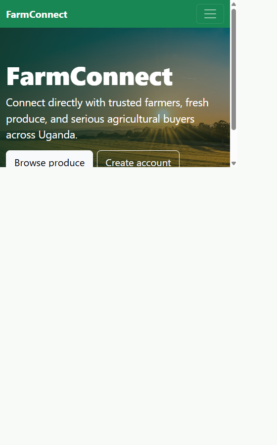
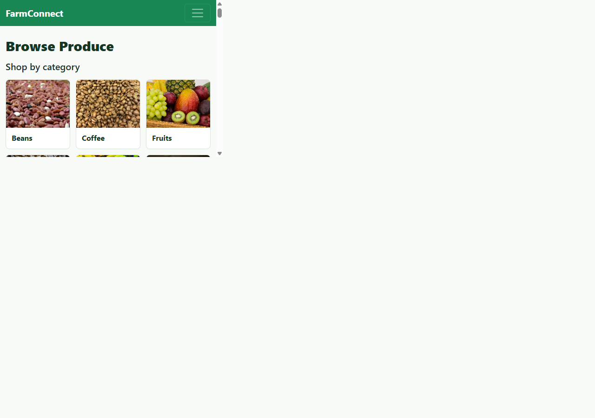
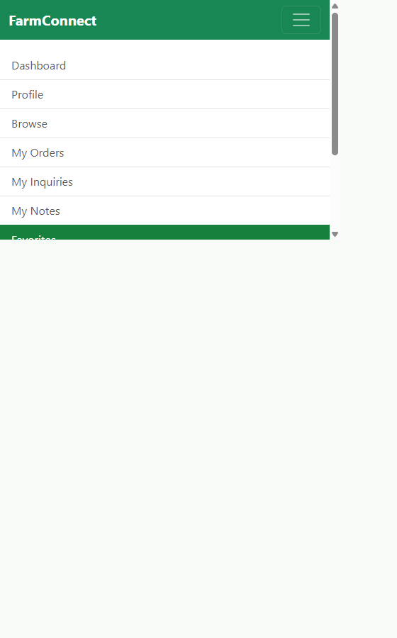
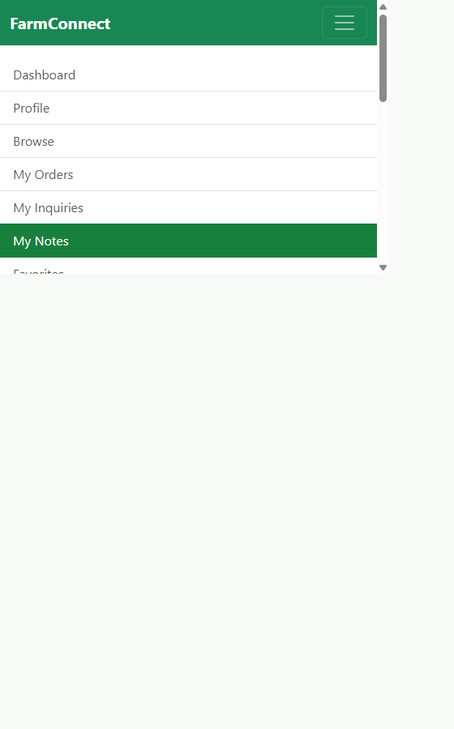
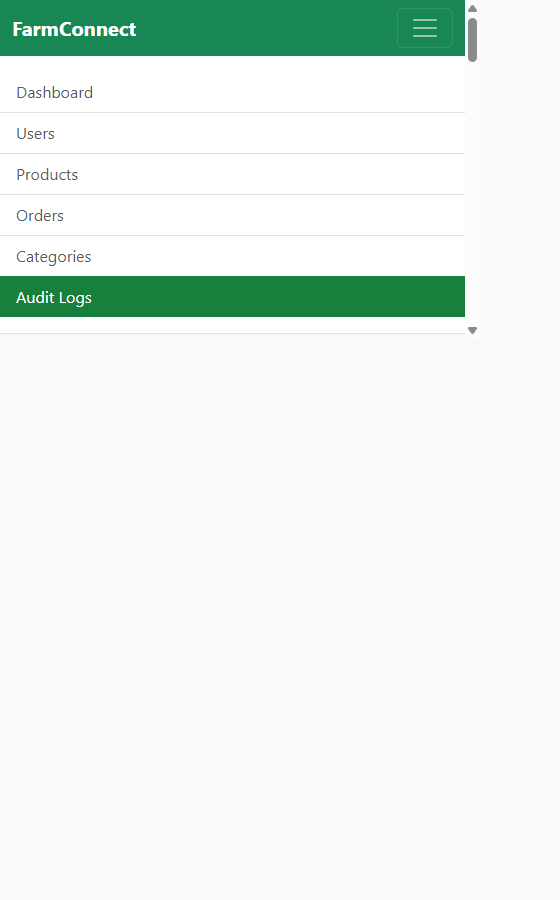

# FarmConnect Test Report

Date: 2026-10-11

## Submission Details

- Student name: **[Enter your name]**
- Student number: **[Enter your student number]**
- Chosen application: FarmConnect agricultural produce marketplace.
- Frontend fork: [aparoolive9-blip/farmconnect-frontend](https://github.com/aparoolive9-blip/farmconnect-frontend)
- Backend fork: [aparoolive9-blip/farmconnect-backend](https://github.com/aparoolive9-blip/farmconnect-backend)
- Original frontend starting commit: `03456156bb6ff0a98588589ef1e898025b945608`
- Original backend starting commit: `be248854e5396604c6b0fe82e5bb6c74f2b9a563`
- Final implementation commit IDs: see the delivery message accompanying this report; commits are made separately in the frontend and backend forks.

## Features and Acceptance Criteria

| Feature | Summary | Acceptance criteria |
| --- | --- | --- |
| Database-backed buyer favorites | Buyers save, list, check, and remove product favorites stored against their account in MySQL. The frontend no longer uses browser-only favorites as a fallback. | A saved favorite is visible after a new login for the same buyer; a different role cannot access buyer favorites; remove returns the list to empty. |
| Buyer product notes | Buyers create, list, update, and delete private reminders attached to products. The database enforces one note per buyer/product. | A valid note persists and updates; blank and duplicate notes are rejected; another buyer cannot edit or delete the note. |
| Admin audit log | Important actions such as favorite and note changes are written to `audit_logs` and shown in the admin UI. | Admin can view recorded feature actions; unauthenticated users and non-admin roles are denied. |

## Environment and Reproduction

- Target: local FarmConnect API at `http://localhost:5000/api`, connected to the seeded `farmconnect` database.
- Seed accounts use `password123`; buyer4 is used for empty-state and write tests.
- Start the backend and database, then run `node tests/api-smoke.js` from `cloned/farmconnect-backend`.
- The smoke test removes the temporary order, favorite, and note it creates. Audit events are intentionally retained by the application.
- Result: **22/22 API checks passed**. Frontend `npm run build` passed. `node --check tests/api-smoke.js` and `node --check server.js` passed.
- Fresh database setup is provided in `database/schema.sql`; `database/seed.sql` includes demo favorites, notes, and audit rows. There is no separate incremental migration. Both scripts reset existing data, so use a disposable development database or back it up first.

### Setup Issues Encountered

- The local database password was initially missing or mismatched with the environment template. It was corrected in the ignored local `.env`; the real value is deliberately not recorded here.
- An old backend process occupied port `5000`; restarting the intended backend resolved the conflict.
- PowerShell does not use the same shell redirection syntax as Bash for loading SQL. The READMEs now include PowerShell `Get-Content ... | mysql` commands.

## Results

| Steps | Expected result | Actual result | Outcome |
| --- | --- | --- | --- |
| Log in as seeded buyer4 with the correct password. | HTTP 200 with a buyer JWT. | HTTP 200; role was buyer. | PASS |
| Log in as buyer4 with an incorrect password. | HTTP 401 with invalid-credentials message. | HTTP 401; “Invalid email or password.” | PASS |
| Submit login with email but no password. | HTTP 400 with required-fields validation. | HTTP 400; “Email and password are required.” | PASS |
| Request `/auth/me` using the buyer token. | HTTP 200 with the authenticated buyer. | HTTP 200; buyer role returned. | PASS |
| Load categories and browse products filtered by category 2. | Active categories and products in that category are returned. | HTTP 200; 8 categories and 1 matching product. | PASS |
| Load product 9 and browse an unmatched category. | Product detail loads; unmatched result is an empty array. | Detail HTTP 200; empty search HTTP 200 with 0 products. | PASS |
| Load the buyer's order history. | HTTP 200 with an orders array. | HTTP 200; 1 existing order returned. | PASS |
| Submit an order with an empty body. | HTTP 400 for missing order fields. | HTTP 400; required product, quantity, and delivery message returned. | PASS |
| Request 999999 units of product 9. | HTTP 400 because requested quantity exceeds availability. | HTTP 400; available-quantity error returned. | PASS |
| Place an order for 1 unit of product 9, then reload buyer orders. | HTTP 201 and the new order appears in the buyer's list. | HTTP 201; order 8 appeared in the list; temporary order was removed afterward. | PASS |
| Load favorites as buyer4 before adding any. | HTTP 200 with an empty list. | HTTP 200; 0 favorites. | PASS |
| Save product 9, check its status and list, then log in again as buyer4 and reload favorites. | Save succeeds and the same account sees it in a separate login session. | HTTP 201; status and list showed the favorite, and it remained visible after a second login. | PASS |
| Delete product 9 from favorites and reload the list. | Delete succeeds and list returns to empty. | HTTP 200; 0 favorites. | PASS |
| Request favorites without a token and then as a farmer. | HTTP 401 without a token; HTTP 403 for the wrong role. | HTTP 401 unauthenticated; HTTP 403 for farmer. | PASS |
| Load notes as buyer4 and submit whitespace-only note text. | Empty notes state; blank note rejected with HTTP 400. | 0 notes; blank note HTTP 400. | PASS |
| Create a note for product 9, repeat the create, update the original, and reload notes. | HTTP 201 create; HTTP 409 duplicate; update is visible. | Create HTTP 201; duplicate HTTP 409; update HTTP 200 and updated text was returned. | PASS |
| Have buyer3 update and delete buyer4's note. | Both ownership violations return HTTP 403. | Update HTTP 403; delete HTTP 403. | PASS |
| Delete buyer4's note and reload notes. | Delete succeeds and list returns to empty. | HTTP 200; 0 notes. | PASS |
| Create a note referencing nonexistent product 999999. | HTTP 404 product-not-found response. | HTTP 404; “Product not found.” | PASS |
| Load audit logs as admin after favorite and note operations. | HTTP 200 and this run's buyer/product events include `favorite_saved` and `note_created`. | HTTP 200; 28 logs returned and both actions matched this run's buyer, product, and note. | PASS |
| Request audit logs without a token and as buyer4. | HTTP 401 unauthenticated; HTTP 403 for buyer role. | HTTP 401 unauthenticated; HTTP 403 for buyer. | PASS |
| Load farmer orders as farmer and admin stats as admin. | Both role-appropriate core dashboard APIs return HTTP 200. | Farmer orders HTTP 200; admin stats HTTP 200. | PASS |

## Frontend Checks

| Steps | Expected result | Actual result | Outcome |
| --- | --- | --- | --- |
| Open Browse Produce at 1280px and inspect all category tiles. | Eight seeded categories display matching photos; every image loads. | 8 tiles; all 8 images had nonzero natural dimensions. | PASS |
| Click Maize. | Tile becomes selected, dropdown uses category 1, and products filter to maize. | `aria-pressed=true`; filter value `1`; Dry Maize Grain and White Maize displayed. | PASS |
| Resize Browse Produce to 390px. | Category tiles remain usable without horizontal overflow. | 8 tiles displayed in a two-column layout; body width 375px with no overflow. | PASS |

## Build Checks

| Steps | Expected result | Actual result | Outcome |
| --- | --- | --- | --- |
| Run `npm run build` from `cloned/farmconnect-frontend`. | Vite completes a production build. | 132 modules transformed; build completed successfully. | PASS |
| Run `node --check tests/api-smoke.js` and `node --check server.js` from `cloned/farmconnect-backend`. | Both JavaScript files pass syntax checking. | Both commands exited successfully with no diagnostics. | PASS |

## Screenshots

Screenshots use seeded demo accounts and contain no real credentials. The full-size PNGs are in `tests/evidence/`.

## Scope Note

### Known Limitations

- Cross-browser persistence was exercised at API level by saving a favorite and fetching it with a newly issued token after a second login for the same account. A separate physical browser session was not driven during this run.
- Setup scripts are for a fresh/disposable database and are destructive; there is no incremental migration for existing installations.
- Category image files are locally bundled, but new categories created by an admin use a generic fruit-photo fallback until a category-specific image mapping is added.
- Seed/demo users use the shared password `password123`; change or remove demo accounts before any public deployment.

### External Work and AI Acknowledgements

- Existing application dependencies include React, React Router, Axios, Bootstrap, Express, `mysql2`, `jsonwebtoken`, and `bcrypt`. No new application package dependency was added for the category image feature.
- Category photo sources, creators, and license notes are listed in the frontend [CATEGORY_IMAGE_ATTRIBUTION.md](../../farmconnect-frontend/CATEGORY_IMAGE_ATTRIBUTION.md).
- GitHub Copilot assisted with code changes, test planning, documentation, and verification. The submitter should be prepared to explain and modify all submitted code.
- The Word version of this report was generated with `python-docx` in the local environment; it is not an application dependency and is not included in either package manifest.

The test harness removes the temporary order, favorite, and note it creates; their audit events remain as expected for durable audit logging.